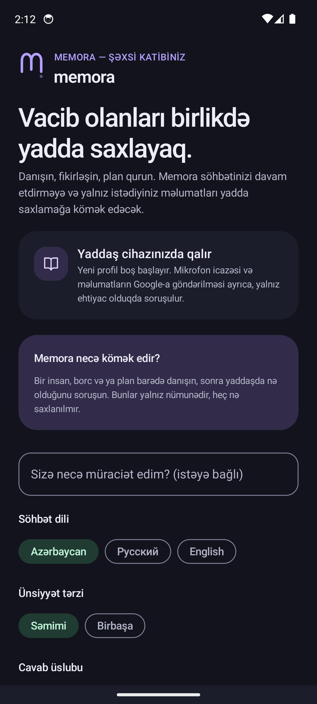
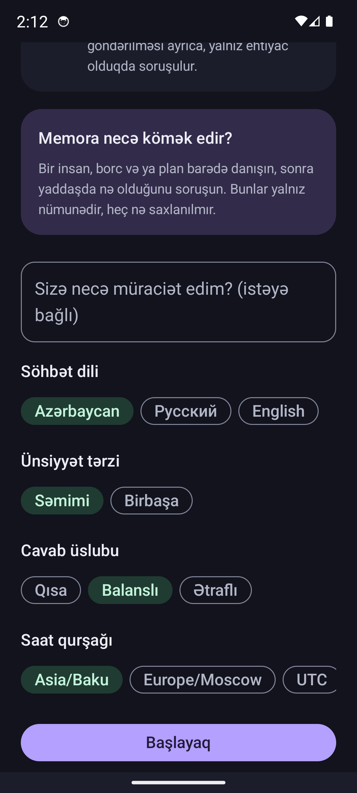
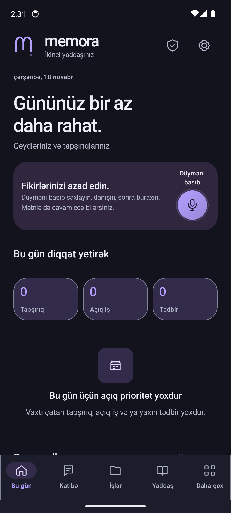
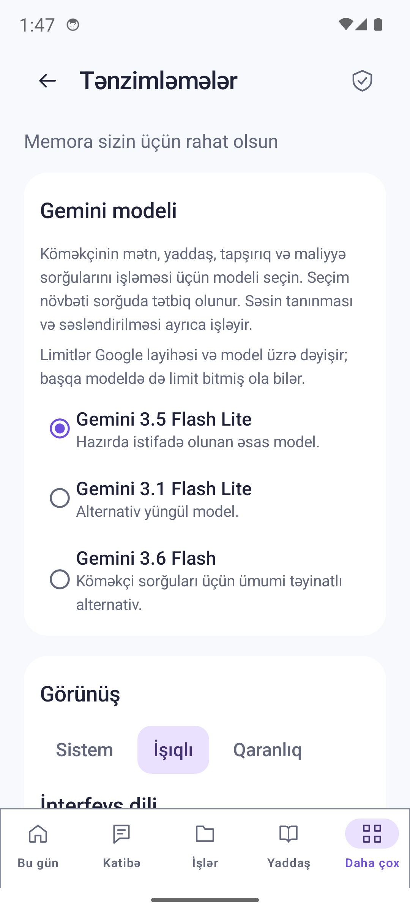
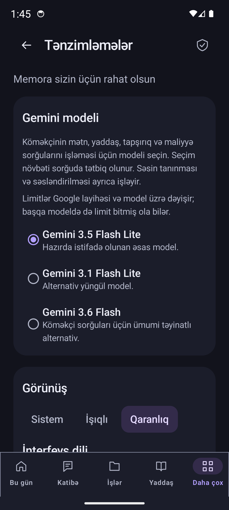
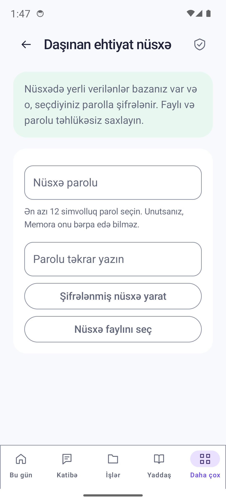
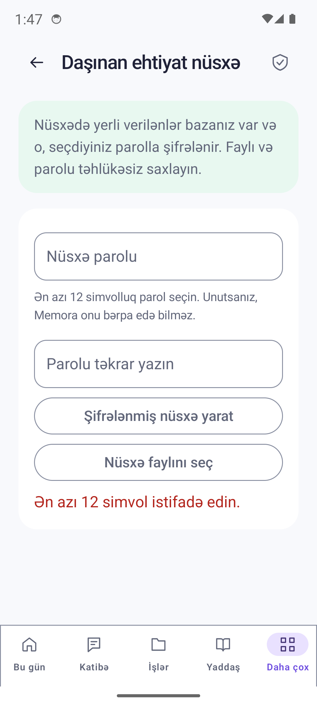
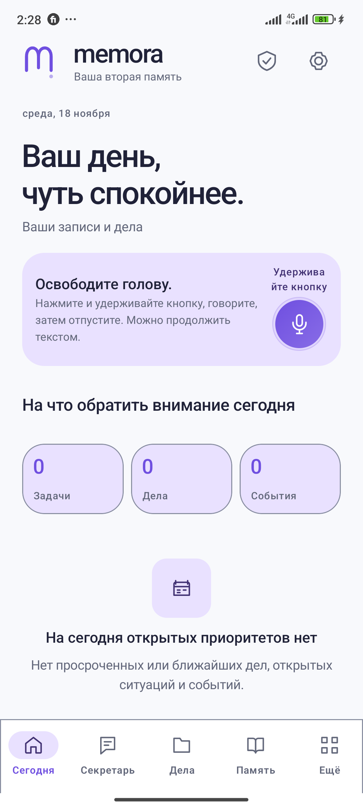

# Backup, Settings, onboarding and visual regression — ACT-0256

**Date:** 2026-11-18
**Branch:** `ui/redesign-v1`
**Status:** this UI/quality slice is verified; M20-05 and overall native acceptance remain partial.

## Implemented

- Grouped Settings into reusable cards for the selected Gemini model, appearance/language, attention, device permissions, and privacy/about controls. Removed the repeated Backup heading because the app shell already supplies the route title.
- Simplified the Backup screen into a separate encryption disclosure and a focused transfer card. Increased the minimum touch height for export/import/restore, confirmation, Settings retry, permission, attention, and debug App Check controls to 48 dp.
- Added an onboarding safe screen that applies `safeDrawing` insets and the active theme background to onboarding, loading, and error states. This fixes the Redmi-observed logo/status-bar overlap and keeps onboarding surfaces consistent in dark mode.
- Added light/dark palette contrast regressions for text, badges, status colors, outlines, and focus boundaries.
- Increased component-gallery settling time to accommodate Android 14 system-bar transitions. Comparison thresholds and the 31 committed image baselines are unchanged.

No database/schema, migration, ledger, domain, consent, AI/provider, privacy, authentication, or permission semantics changed.

## Verification

Full command, from `apps/android`:

```sh
ANDROID_SERIAL=emulator-5556 JAVA_TOOL_OPTIONS='-XX:TieredStopAtLevel=1' ./gradlew :app:testDebugUnitTest :app:assembleDebug :app:assembleDebugAndroidTest :app:compileDebugAndroidTestKotlin :app:lintDebug :app:componentVisualRegression --no-daemon --console=plain --max-workers=1
```

- **PASS:** Gradle `BUILD SUCCESSFUL`; JVM XML reports **80 suites / 411 tests, 0 failures, 0 errors, 1 opt-in live test skipped**.
- **PASS:** debug APK and AndroidTest APK assembled; AndroidTest Kotlin compiled.
- **PASS:** lint reports **0 errors / 90 warnings / 2 hints**.
- **PASS:** all **31/31** component screenshots matched their existing baselines; thresholds were not relaxed and baselines were not rewritten.
- **PASS:** onboarding contrast tests and the existing onboarding/profile UI tests ran in the full JVM suite.
- APK: `ai.memora.app`, versionCode **105**, versionName **1.1.83-ui-accessibility-polish**, SHA-256 `3ebb322a2642994dc85eb98b98522ead400b09d50ca5aa6340efc3ee283efc81`.
- **PASS, synthetic Android 14 emulator:** after resetting only the disposable emulator profile, v105 opened onboarding in Azerbaijani. At fontScale 1.3 the lower choices and “Başlayaq” remain reachable by scrolling. Completing the profile opened Today; after force-stop/relaunch Today and Azerbaijani remained, and onboarding did not reappear. The test profile contained no real personal data.
- **PASS, physical Redmi 2201117SG / Android 13:** v105 was installed over the prior APK with `adb install -r`; `firstInstallTime` remained `2026-11-18 02:05:36`. MainActivity opened. The visible Today counters were 0 tasks, 0 cases, and 0 events, with no open priorities. Only the rendered screen was checked; the private database was not read. No device data was cleared.
- `git diff --check` passed before documentation packaging.

The visible zero counters establish that the Redmi dashboard is empty for those three displayed categories. They do not establish that every local store or settings value on the phone is empty.

## Evidence screenshots

All images below are direct Android screenshots. Settings and Backup shots are from v104; those routes are unchanged in v105, whose final change in this slice was the onboarding insets/theme fix. The Redmi screenshot is v105.

### Onboarding and first run







### Settings and backup at larger text









### Physical Redmi



## Not tested / still open

- The Redmi onboarding was not reset; physical onboarding completion and repeat-launch behavior were checked only on the synthetic emulator.
- TalkBack, a hardware keyboard, physical-device fontScale 1.3, process-death restoration, and populated-profile data readback after upgrade remain **NOT TESTED**.
- Backup import/export and SAF round-trip were not run; the blank-passphrase validation check did not create or restore a backup.
- No live Gemini, microphone/audio, network-performance, or paid API call was made.
- End-to-end scenarios B–G, device consent-state persistence, owner acceptance, native acceptance, and release readiness remain open. No production-readiness claim is made.

M20-05 remains **partial**. Continue the authorized UI work from the remaining synthetic end-to-end/navigation and device-acceptance gaps; keep `main` and owner-owned ADR-012 untouched.

## Git handoff

Implementation commit `c23858223935b1637c69bd8633716fcd9de4c493` is pushed to `origin/ui/redesign-v1`. Local HEAD, tracking ref, and remote feature ref were verified equal after push. Remote `main` remains `ac621919aca09ece6e292eae708d55cc09de16d7`; no merge or history rewrite. Owner ADR-012 remains untracked and excluded.
