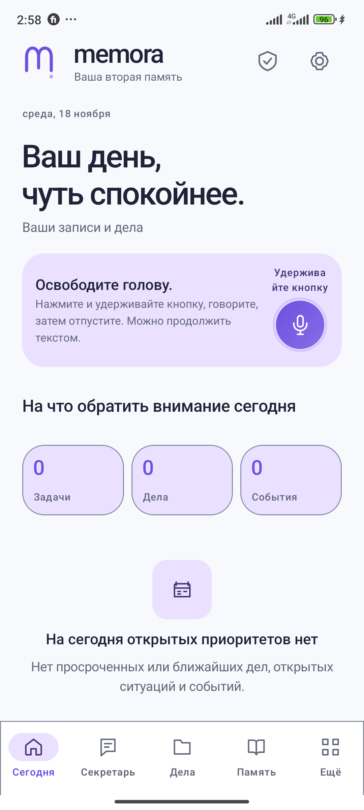
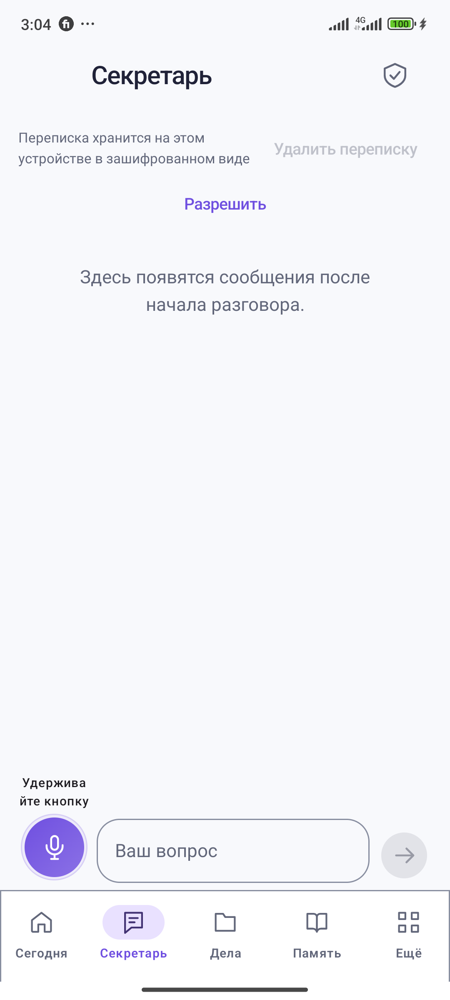
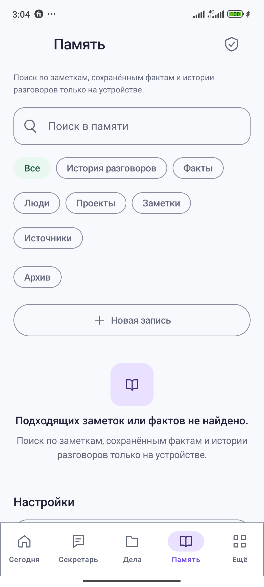
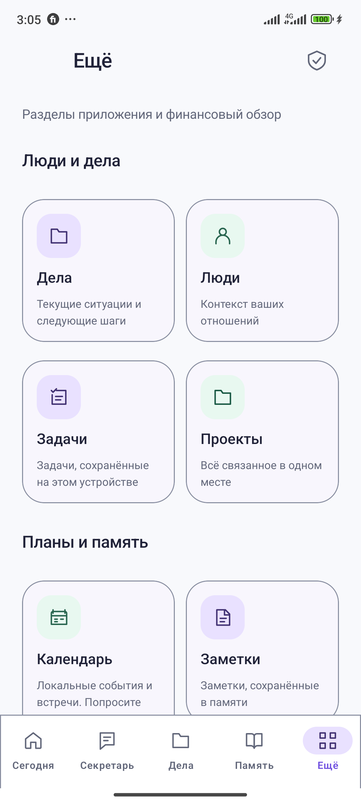
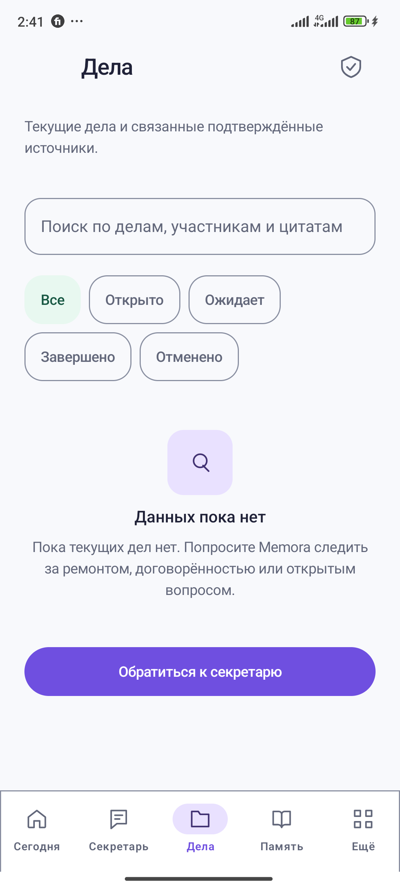
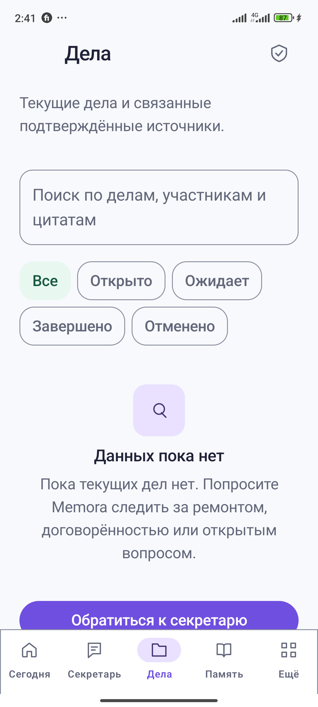
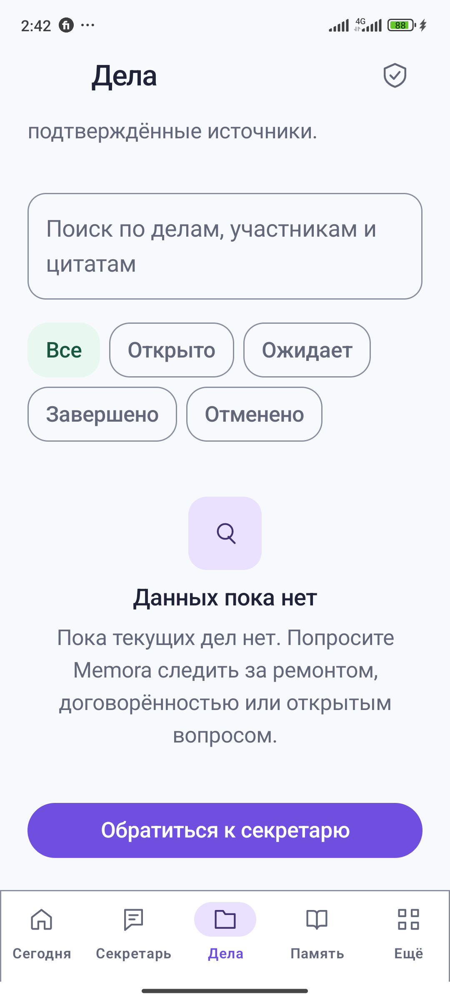
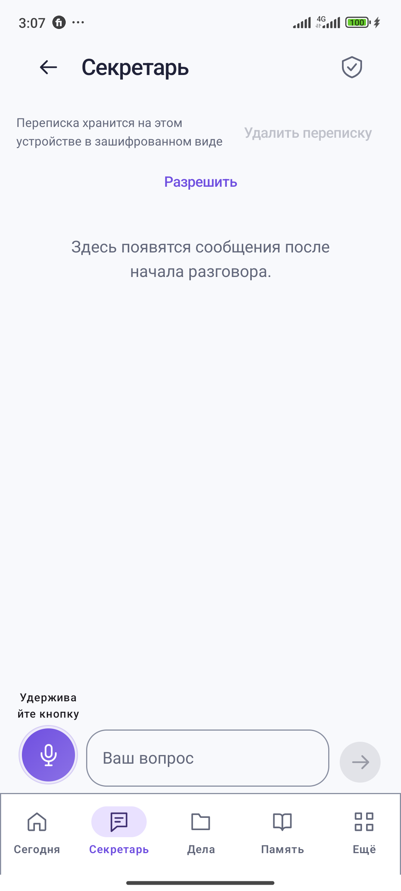
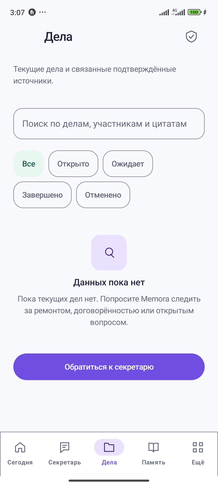
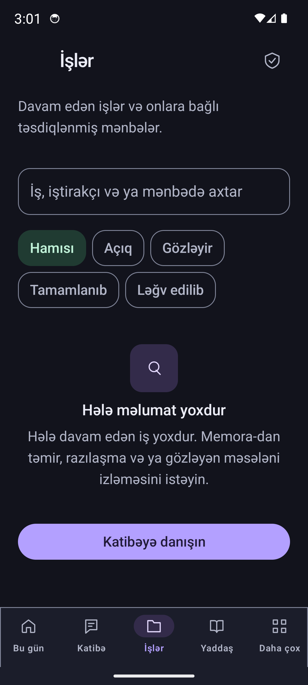

# Cases status filters on narrow screens — ACT-0258

**Date:** 2026-11-18
**Branch:** `ui/redesign-v1`
**Status:** the confirmed Cases filter-clipping defect is fixed and verified; M20-05 and native acceptance remain partial.

## Finding and change

On the connected Redmi, the five Cases status filters were placed in a horizontally scrolling row. The final filter could be clipped at the right edge, which made it hard to discover. `CasesScreen` now lays the chips out with a wrapping `FlowRow`; each chip retains a minimum 48 dp touch height. Filter selection and paging behavior are unchanged.

Added a Compose regression at `fontScale=1.3`. It asserts that all five filters are displayed and that the empty-state action remains reachable by vertical scrolling. No database, schema, migration, ledger, domain, AI/provider, consent, privacy, authentication, or permission behavior changed.

## Verification

- **PASS:** focused `CasesAndPersonCardTest`: 9 tests, 0 failures/errors/skips.
- **PASS:** full Gradle command from `apps/android`:

  ```sh
  ANDROID_SERIAL=emulator-5556 JAVA_TOOL_OPTIONS='-XX:TieredStopAtLevel=1' ./gradlew :app:testDebugUnitTest :app:assembleDebug :app:assembleDebugAndroidTest :app:compileDebugAndroidTestKotlin :app:lintDebug :app:componentVisualRegression --no-daemon --console=plain --max-workers=1
  ```

  Result: `BUILD SUCCESSFUL`; 80 JVM suites / 412 tests, 0 failures, 0 errors, 1 opt-in live test skipped; debug and AndroidTest APKs assembled, AndroidTest Kotlin compiled; lint 0 errors / 90 warnings / 2 hints; visual regression 31/31 PASS. Existing image baselines and comparison thresholds were unchanged.
- **PASS, physical Redmi Note 2201117SG / Android 13:** v106 was installed over v105 with `adb install -r`. Package manager reports versionCode 106, `firstInstallTime=2026-11-18 02:05:36`, `lastUpdateTime=2026-11-18 02:40:51`; the original install time survived the update. The five Russian filters are fully visible at system font scale 1.3; the screen's empty-state action is visible after scrolling. System font scale was restored to 1.0. No app data was cleared and the private database was not read.
- **PASS, synthetic Android 14 emulator:** the Azerbaijani screen was checked at font scale 1.3; all five translated filters wrap into two rows and remain visible, and the empty-state action is reachable by scrolling. Emulator font scale was restored to 1.0.
- **PASS, physical Redmi navigation:** tapping the empty Cases action opened Secretary; Android Back returned to the Cases screen with the same empty state and selected “All” filter. The microphone and consent controls were not tapped.
- **PASS:** `git diff --check` before packaging.

APK: `ai.memora.app`, versionCode 106, versionName `1.1.84-case-filter-wrap`, SHA-256 `ab7628e61b4c6b7981045d2c8181c1698228fd7a5717d9a63245e7fdc2f08fb2`.

## Screenshots

All images are direct Android screenshots; device screenshots show the Redmi's Russian UI. Azerbaijani large-text screenshots are from the synthetic Android 14 emulator.

### Redmi, visible routes v106

These read-only captures document what was visible in the app. Empty screens and zero counters do not prove that every local store is empty.









### Redmi Cases filters, physical device







### Redmi route and Back behavior





### Azerbaijani, synthetic Android 14 emulator




## Limits

The device's visible Today, Secretary, Cases, Memory, and More routes appeared empty during read-only review; Today showed zero tasks, cases, and events. This describes the rendered screens only. The private database and less visible stores were not inspected, so this does not prove every local store is empty. No user records were created, modified, or deleted.

TalkBack, populated-profile update/readback, physical AZ locale, keyboard, backup/SAF round-trip, live Gemini/audio and owner acceptance were not tested by this slice. M20-05, M20-08 and release readiness remain partial/open.

## Git handoff

Implementation, regression test, report and screenshots are committed as `6ac8d61822fdd4c4d79dc6bcf0ad77c5e5540055` (`fix(ui): wrap case status filters on narrow screens`) and pushed to `origin/ui/redesign-v1`. Fetch, local HEAD, tracking ref and `git ls-remote` confirmed that feature SHA. Remote `main` remains `ac621919aca09ece6e292eae708d55cc09de16d7`; no merge or history rewrite. Owner-owned `docs/adr/ADR-012-keystore-wrapping-key-rotation.md` is excluded.

The later read-only Redmi Back-stack evidence was documented separately as ACT-0260; it does not change the v106 implementation or test result.
